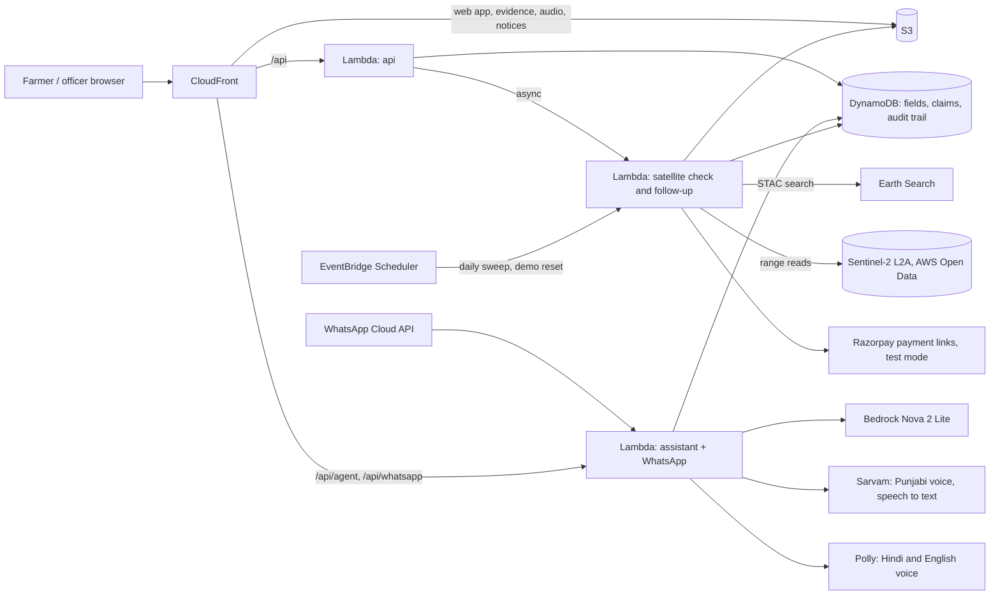

# Saakshi (साक्षी)

Saakshi pays farmers part of the no-burn incentive before harvest, checks every field from satellite pictures
afterwards, and gives the village officer the evidence for the cases the pictures cannot settle. Farmers use it
in Punjabi, Hindi, Haryanvi or English, on the web or on WhatsApp, by text or by voice.

**Live:** https://d5gpae5oilzws.cloudfront.net · Officer PIN `2468` · The demo's cases reset every day at 05:00 IST.
The WhatsApp side runs on a Meta test number, so it is shown in the video rather than open to the public.

Environmental Hacks 2026, Air track.

## The problem

Every November, smoke from burnt paddy straw in Punjab and Haryana settles over north India. On 22 Nov 2024 farm
fires were about 26% of Delhi's PM2.5 (IITM estimate in the CPCB air quality bulletin of 23 Nov 2024). The state has two levers,
and both work badly:

- **Fire alerts as evidence.** NASA's thermal fire alerts (VIIRS, 375 m) lead to a red entry on the farmer's
  record, an FIR, and environmental compensation of ₹5,000–30,000 per incident. In our labelled sample the
  alerts flagged 9.0% of clean fields and caught only 19% of burns: a field can be burnt and ploughed between two
  satellite passes, and a fire next door lands on your record.
- **Paying after a manual check.** Haryana paid ₹1,000 an acre for managing straw without burning in 2024,
  after a village committee checks GPS-tagged photos. A randomised trial in 171 Punjab villages (Jack,
  Jayachandran, Kala and Pande, "Money (Not) to Burn"; J-PAL, MIT CEEPR) found that paying only after
  verification did not reduce burning, while paying 25% or 50% upfront raised compliance by about 10 percentage
  points, roughly doubling it.

Paying upfront at scale needs a check that is cheap enough to run on every field, fast enough to pay on time,
and fair enough to defend when a farmer disputes it.

## What it does

1. **Before harvest, the advance.** Each registered field is checked against last season's Sentinel-2 pictures.
   Clean last season: half the incentive is paid now (simulated direct benefit transfer). Not clean: no advance
   this year.
2. **After harvest, the check.** Every clear picture of the field from 1 Oct to 30 Nov is read from the AWS Open
   Data copy of Sentinel-2. Fixed rules look for a burn: the plant signal collapses in one step and the ground
   turns near-black. Clean fields are approved and the balance is released.
3. **The officer decides the rest.** Unclear fields and every possible burn go to the village officer with the
   colour and infrared pictures, the plant signal through the season, nearby fire alerts and last season's
   result. When the officer confirms a burn on a field that got an advance, Saakshi drafts a recovery notice
   with the evidence and sends a payment link (Razorpay, test mode). Fines, red entries and cases stay human
   decisions.
4. **The farmer is told, and can answer back.** The decision reaches the farmer in their language, as text and
   a voice note, in the app and on WhatsApp: what the satellite saw, where their money stands, and how to
   appeal. An appeal sends the case back to the officer and cancels any open payment link.

The public map shows the whole Patiala–Kaithal border belt through the 2025 season: burn-like ground, fire
alerts, and an estimate of the smoke. Anyone can open a field and run the same satellite check.

## Results

749 plots in two study areas (Patran in Patiala, and Kaithal) were labelled burnt, not burnt or unsure from the
season's pictures; unsure plots are left out. Plots were sampled by distance to fire alerts and by burn signal,
and weighted back to the whole area. A human labeller made the first pass; an AI assistant re-read 249 of the
plots on full-season strips. See [Labels](#labels), including the numbers on the human labels alone.

| | Saakshi | Fire alerts alone (375 m) |
|---|---|---|
| Clean fields wrongly flagged | **0.6%** | 9.0% |
| Burnt fields approved without an officer | **none of 111** | n/a |
| Flags that were real burns (precision) | 75% | 6% |
| Burns caught | every labelled burn went to the officer | 19% |

Scored on 593 labelled fields, 111 of them burnt. Reproduce with `uv run python scripts/check_numbers.py`.

**The advance rule.** On 262 plots labelled earlier in the Patran area, fields that were clean in 2024 burnt in
2025 at 1.8%; fields that were not clean in 2024 burnt at 8.6%. 78% of cropland would get the advance.

**Smoke.** Across the belt, 3,059 ha looked burnt by 10 Dec 2025 against 357 fire alerts. At about 46 kg of
PM2.5 per burnt hectare (2.6 t of straw an acre, 80% burnt, about 9 kg of PM2.5 a tonne), that is roughly
140 t of PM2.5 from one belt in one season. Each field kept clean keeps about 19 kg an acre out of the air.
These are estimates for scale, not measurements; the Sources note on the map gives the basis.

Method, sampling and caveats: [`docs/evaluation.md`](docs/evaluation.md).

## Model and code

Language models help the farmer ask and understand; code makes and states every decision. Details:
[`docs/safety.md`](docs/safety.md).

- Decisions are fixed rules (`src/parali/rules.py`, thresholds in `rules.toml`), fitted on the hand labels.
- The assistant (Amazon Nova 2 Lite on Bedrock, through the Strands Agents SDK) can use seven tools: list the
  farmer's fields, read the claim, read the advance, file a claim, explain the decision, record an objection,
  ask for a call. None can approve, reject, pay or penalise.
- When a tool ran, the farmer hears text composed from the decision record, never the model's own words. A
  model reply that states a decision without a tool result is dropped; a long or list-like reply is replaced by
  the fixed help text.
- Every message about money is a fixed template in each language. Machine translation is used only for the
  model's short clarifying question, and only if its numbers and currency signs survive unchanged.
- If Bedrock is slow, throttled or over the daily cap, a rule-based assistant answers instead.
- An officer confirms every burn. Each decision keeps the pictures and the rule that fired.

## How it is built



| Piece | Job |
|---|---|
| Sentinel-2 L2A on AWS Open Data | Pictures, read in place: only the pixel window around each field |
| Lambda (Python) | Satellite check, API, assistant and WhatsApp webhook, map tiles |
| DynamoDB | Fields, claims, decisions, audit events |
| S3 + CloudFront | Web app, map tiles, evidence images, voice notes, recovery notices |
| Bedrock (Nova 2 Lite) + Strands Agents SDK | Understands the farmer's request and picks a tool |
| Sarvam AI | Punjabi voice (bulbul), speech to text in Punjabi, Hindi and English (saarika) |
| Polly, Transcribe | Hindi and English voice; Hindi speech to text as a fallback |
| WhatsApp Cloud API | Pick or name a farmer, get the status, tap Why / My money / Appeal, by text or voice |
| Razorpay (test mode) | Payment link to return an advance after a confirmed burn |
| EventBridge Scheduler | Daily sweep of open claims; daily demo reset |
| SSM Parameter Store | API keys and tokens, never in code or the repo |
| SAM / CloudFormation | Everything above in one stack (`infra/template.yaml`) |

Payments to farmers (the advance and the balance) are simulated. Only the farmer's repayment goes through a real
payment gateway, in test mode.

## Run it locally

Needs Python 3.12 and [uv](https://docs.astral.sh/uv/). No AWS account needed.

```
uv sync
uv run parali demo
```

Open http://127.0.0.1:8080 and press **Play the season**. Officer PIN `2468`. The demo fields and their 2024
and 2025 imagery are in `data/demo`. With AWS credentials, `uv run --extra aws --extra agent parali demo --aws`
uses Bedrock, Polly and Transcribe; set `SARVAM_API_KEY` for Punjabi voice.

## Tests and checks

```
uv sync --extra dev --extra aws --extra agent
uv run pytest                              # unit, parity and property tests
uv run python scripts/plant_bugs.py        # 27 deliberate bugs in the rules, money and guards; all must be caught
uv run python scripts/check_numbers.py     # headline numbers recomputed from the labels
uv run python scripts/smoke.py             # end-to-end check of the live site (changes the demo; reset after)
uv run python scripts/reset_demo.py        # fresh demo cases
```

The parity tests check that every string exists in every language, that a claim shows the same amounts on every
screen and in every message, and that the server and the web app use the same smoke estimate. The property tests
run generated claims through approvals, burns, appeals and repayments and check that the money always adds up.

## Deploy

```
uv run --extra aws python scripts/deploy.py   # sam build + deploy, web upload, demo fields
```

API keys go in SSM under `/saakshi/` (WhatsApp, Razorpay, Sarvam); the stack reads them at run time.

## Labels

- **First pass, by hand:** 749 plots (`labels.csv`), labelled by the team from strips of up to 12 dates.
- **Second read, by AI:** the 12-date strips could skip the date a field burnt and was ploughed, so Claude Code
  re-read 249 plots on strips showing every clear date (`labels_claude.csv`). 42 Patran plots first marked not
  burnt or unsure were clear burns on a date the old strips had hidden; none changed in Kaithal. The headline
  uses the first pass with these re-reads on top (`labels_full_strips.csv`).
- **Human labels alone,** for comparison: 615 fields, 69 burnt; Saakshi wrongly flagged 1.6% of clean fields
  against 8.7% for fire alerts, flag precision 38%, and no burnt field was approved without an officer. Both
  versions come out of `scripts/check_numbers.py`.

The re-read plots were picked by their burn signal, so this set leans toward agreeing with the rules; the
weights correct the rates for the whole area, not for that selection.

## Limits

- Field outlines are samples drawn on the 20 m grid; there is no public cadastral map.
- Labels are readings of 10–20 m pictures, not site visits, and 111 burnt plots is a small sample.
- Satellites see fields, not people: a tenant who burnt elsewhere looks clean on a new field.
- Fields under about one acre have too few whole pixels and go to the officer.
- The trial's effect on burning is the trial's result, not ours. Recovering an advance is administratively
  hard; Saakshi only makes it evidence-backed.
- The smoke figures are estimates from published emission factors, not air-quality measurements.

## Team and AI tools

Vidit Choudhary chose the problem, designed the scheme (advance, check, officer, recovery, appeal), made the
product and policy decisions, labelled the first 749 plots, set up AWS, WhatsApp and Razorpay, and tested on real
phones. Claude Code (Anthropic) wrote most of the code, the interface text and the analysis scripts under that
direction and review, and made the second read of 249 plots described in [Labels](#labels).
