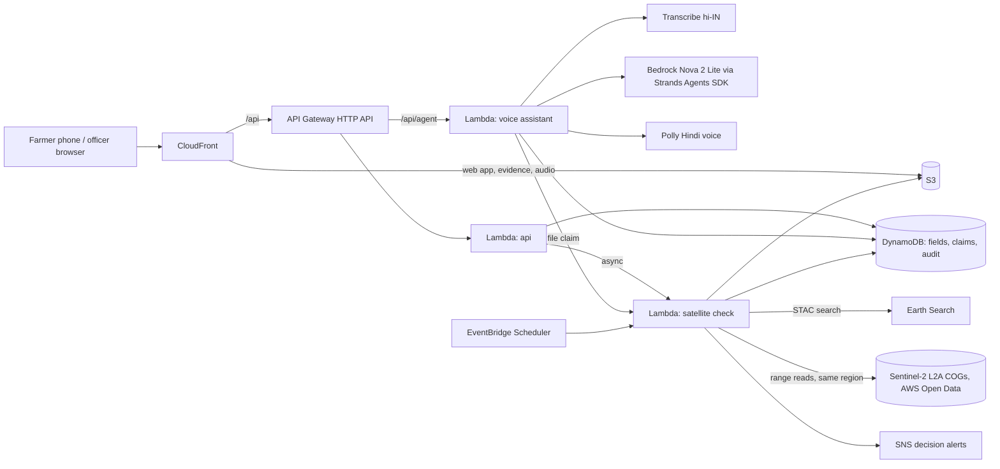

# Parali Check

**Pay farmers before harvest for not burning paddy straw. Check every field from space after.**

Live: https://d5gpae5oilzws.cloudfront.net · Try it locally in two minutes: [below](#run-it-locally)

Every November, smoke from burning paddy straw in Punjab and Haryana settles over north India. On 22 Nov 2024
farm fires were about 26% of Delhi's PM2.5 (IITM decision support system, CPCB bulletin). Haryana has two
levers against it, and both are broken:

- **The stick.** Thermal fire alerts (NASA FIRMS / VIIRS) trigger a red entry on the farmer's record: no MSP
  sale for two seasons, an FIR, up to Rs 30,000 in environmental compensation. In our measurement those
  alerts flagged **14% of clean fields** and caught **14% of burns**: fields are burnt and ploughed between
  satellite passes.
- **The carrot.** Rs 1,200 per acre for managing straw without burning, paid **after** a slow manual check.
  A randomised trial in Punjab (J-PAL / MIT CEEPR) found that paying only after verification barely changed
  behaviour, while paying **25% upfront** raised compliance by **8 to 11 percentage points**.

Paying upfront at scale needs verification that is cheap, fast and fair for every field. That is what this
builds.

## What it does

1. **Before harvest:** each registered field is checked against last season's Sentinel-2 images. Clean last
   season: 25% of the incentive is paid now. Not clean: no advance this year; one clean season earns it back.
2. **After harvest:** every clear image of the field from 1 Oct to 30 Nov is read straight from the AWS Open
   Data registry. Fixed rules look for the signature of a burn: near-infrared drops in one step and the
   field turns near-black. Clean fields are approved and the balance released automatically.
3. **Officer confirms:** unclear cases and every possible burn go to the village officer with the images.
   A confirmed burn on an advanced field gets a recovery notice drafted with the evidence. Fines, red
   entries and cases stay human decisions.
4. **The farmer asks in Hindi.** A voice assistant (Amazon Transcribe, Bedrock, Polly) tells them the
   advance, the status, the reason, and records objections.

Anyone can also **draw a field on the map** and see what the rules say about it for 2024 and 2025.

## Measured

314 plots of 80 m in west Kaithal, labelled by hand from the 2025 image series (20 burnt), sampled by
distance to fire points and by burn signal, weighted back to the whole area.

| | Satellite check | Fire alerts alone (FIRMS, 375 m) |
|---|---|---|
| Clean fields flagged | **2.6%** (held-out halves: 4.8%, 4.9%) | **14.1%** |
| Burnt fields approved without a human | **0%** (held-out: 0%, 6.4%, i.e. one plot) | n/a |
| Burns caught | every labelled burn went to the officer | 14.1% |
| Claims settled without an officer | 76% (held-out: 84%, 82%) | none |

Advance rule, checked on 2024 vs 2025: fields clean in 2024 (78% of cropland) burnt in 2025 at **1.8%**;
fields not clean in 2024 at **8.6%**.

Method, numbers and caveats: [`docs/evaluation.md`](docs/evaluation.md).

## Where AWS fits



| Service | Job |
|---|---|
| AWS Open Data (Sentinel-2 L2A COGs) | Imagery, read in place: only the pixel window around each field |
| Lambda | Satellite check (rasterio, 29 scenes in about 10 s), API, voice assistant |
| API Gateway (HTTP API) | `/api/*` |
| DynamoDB | Fields, claims, decisions, audit events, usage cap |
| S3 + CloudFront | Web app, evidence images, Hindi audio, recovery notices, imagery cache |
| Bedrock (Nova 2 Lite) + Strands Agents SDK | Understands the farmer's request and picks a tool. Never decides. |
| Transcribe (hi-IN streaming) | Farmer's voice to text |
| Polly (Kajal, hi-IN) | Every answer read aloud in Hindi |
| SNS | Decision alerts |
| EventBridge Scheduler | Daily sweep of open claims |
| SAM / CloudFormation | Everything above, one stack (`infra/template.yaml`) |

## Model vs code

The AI understands; code decides and states the facts. Details: [`docs/safety.md`](docs/safety.md).

- Decisions are fixed rules (`src/parali/rules.py`, thresholds in `rules.toml`), fitted on hand labels.
- The assistant's seven tools can read records, file a claim, record an objection or ask for a call. None can
  approve, reject, pay or penalise.
- When a tool ran, the farmer hears text composed from the decision record, not the model's own words. A
  model reply that states a decision without a tool result is dropped.
- If Bedrock is slow, throttled or over the daily cap, a rule-based assistant answers instead, and the app
  says so.
- An officer confirms every burn. Every decision stores the images and the rule that fired.

## Run it locally

Needs Python 3.12 and [uv](https://docs.astral.sh/uv/). No AWS account needed.

```
uv sync
uv run parali demo
```

Open http://127.0.0.1:8080 and press **Play the season**. Officer PIN: `2468`. The five demo fields and their
2024 and 2025 imagery are in `data/demo`, so nothing is downloaded. Without AWS, voice uses the browser's
speech recognition and speech synthesis. With AWS credentials, `uv run parali demo --aws` uses Transcribe,
Bedrock and Polly.

## Tests

```
uv sync --extra dev --extra aws --extra agent
uv run pytest                       # 140 tests
uv run python scripts/plant_bugs.py # 14 deliberate bugs in the rules; CI fails if any survives
```

## Deploy

```
uv run --extra aws python scripts/deploy.py   # sam build + deploy, web upload, demo data
```

## Limits

- Field boundaries are hand-drawn samples; there is no public cadastral map.
- Labels are one person's reading of 20 m images, not site visits; 20 burnt plots is a small sample.
- Satellites track fields, not people: a tenant who burnt elsewhere looks clean on a new field.
- Fields under about one acre have too few whole pixels and go to the officer.
- The trial's effect on burning is the trial's result, not ours. Recovering an advance is administratively
  hard; this only makes it evidence-backed.
- Phone calls to farmers need an Indian number (KYC, weeks); the app plays the Hindi audio instead.

Environmental Hacks 2026, Air track. Work started 8 Oct 2026.
