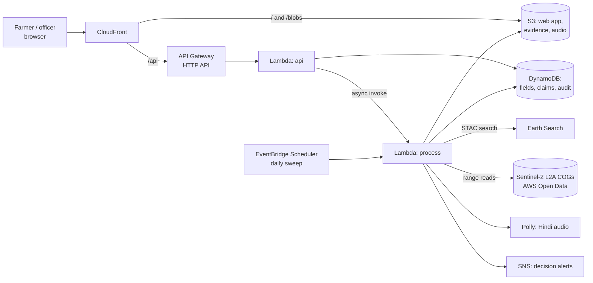

# parali

Haryana pays farmers Rs 1,000 per acre for not burning paddy straw. Today a village team checks each claim by
hand, and thermal fire satellites that flag farmers for penalties are often wrong: the state reported that over
35% of flagged locations had no fire on the ground.

This project checks a no-burn claim against free Sentinel-2 images of the field for the whole season. Clear cases
are approved straight away. Anything unclear goes to the village officer with the images attached. The system
never rejects a claim on its own; a burn finding is always "possible burn, officer to confirm".

Environmental Hacks 2026, Air track. Work started 8 Oct 2026.

**Live:** https://d5gpae5oilzws.cloudfront.net (officer view PIN `2468`; "Reset demo" clears all claims)

## Run it locally (no AWS account needed)

Needs Python 3.12 and [uv](https://docs.astral.sh/uv/).

```
uv sync
uv run parali demo
```

Open http://127.0.0.1:8080. File a claim for any of the five demo fields (real fields in west Kaithal, 2025
season). The officer view uses PIN `2468`. Saved imagery for the demo fields is in `data/demo/stacks`, so nothing
is downloaded.

## Architecture (AWS, us-west-2)



The process function reads only the pixel window around each field from the Sentinel-2 cloud-optimised GeoTIFFs
in the AWS Open Data bucket, in the same region. It runs the same Python code as the local demo.

## How it decides

For every clear image of the field from 1 Oct to 30 Nov it computes the burn index (NBR), near-infrared,
visible brightness and the share of the field that looks dark. Then fixed rules in
[`src/parali/rules.py`](src/parali/rules.py), with thresholds in [`rules.toml`](src/parali/rules.toml):

| Outcome | When |
|---|---|
| possible burn | NIR falls sharply between two clear images, and a large share of the field turns dark and near-black, and stays that way on the next clear image |
| needs review | too few clear images, dark on one image only, part of the field dark, a NASA FIRMS fire point nearby without a scar, or the field is too small for 20 m pixels |
| auto approved | none of the above |

No model takes part in the decision. The farmer message is fixed text per outcome, read out in Hindi by Amazon
Polly.

## Tests

```
uv sync --extra dev
uv run pytest
```
